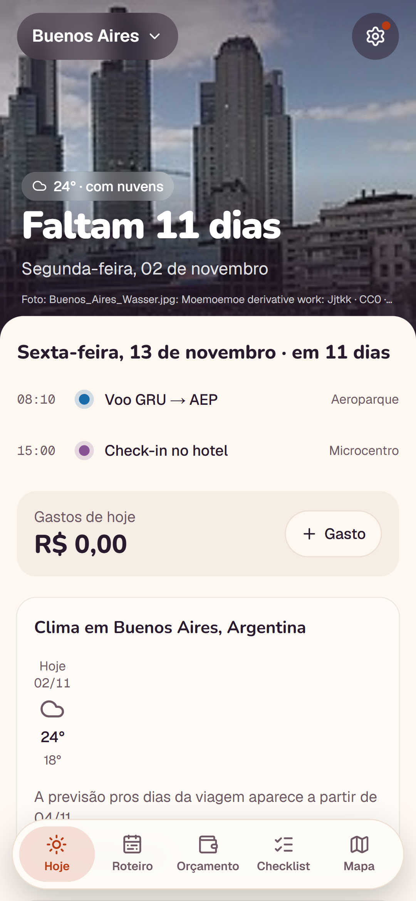
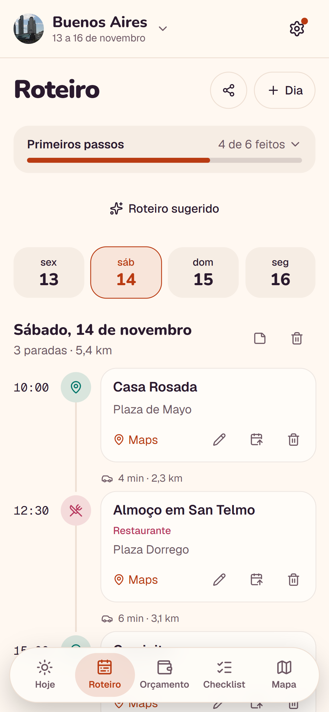
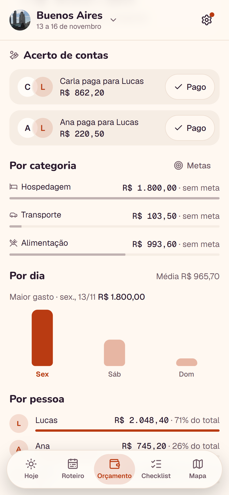
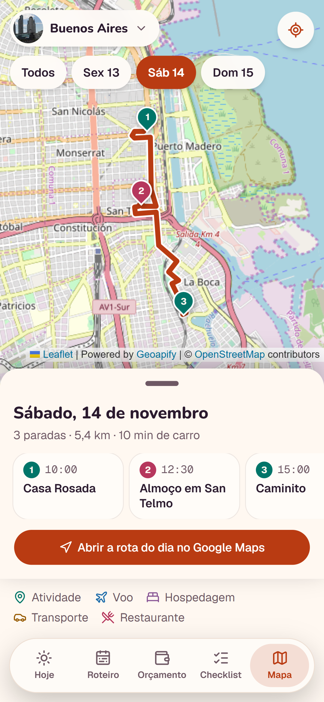

# Partiuu!

Planeje viagens em grupo com roteiro, gastos compartilhados e tudo o que o grupo precisa levar.

[Site](https://partiuu.app.br) · [Google Play](https://play.google.com/store/apps/details?id=br.app.partiuu)

Este repositório apresenta o produto e suas decisões de engenharia. O código do app é privado.

## Telas

As imagens ficam em [`screenshots/`](screenshots/), com instruções para adicionar as capturas.

### Hoje

### Roteiro

### Gastos

### Roteiro sugerido

### Mapa

## O que faz

- Organiza o roteiro por dia, com horário das atividades e local no mapa.
- Divide gastos entre o grupo e calcula o acerto de contas: quem paga quem.
- Trata gastos em outra moeda, com cotação e IOF.
- Reúne documentos da viagem e checklist de mala.
- Sugere um roteiro com IA a partir do ritmo e dos interesses escolhidos. A IA distribui lugares de uma lista real do destino pelos dias da viagem; a pessoa revisa dia por dia e confirma antes de gravar.
- Funciona no site e no app Android, também offline: alterações salvas sem sinal são enviadas quando a conexão volta.

## Stack

| Área | Tecnologias |
| --- | --- |
| Site | Next.js 16, App Router, Server Components e Server Actions |
| Interface | React 19, TypeScript e Tailwind CSS 4 |
| Autenticação | Auth.js, com Google ou código por e-mail |
| Dados | Postgres e Drizzle ORM |
| App nativo | Expo / React Native |
| IA | Google Gemini, Interactions API com saída em JSON Schema |
| PWA | Service worker e Web Push |
| Testes | Vitest e Playwright, com checagem de acessibilidade nos testes e2e |

## Arquitetura

O monorepo tem três partes: o site Next.js, o app Expo e um pacote de lógica pura compartilhado. No site, as leituras ficam em uma camada só de servidor e as escritas passam por Server Actions. O app usa a API versionada `/api/v1`, com login por token.

O pacote compartilhado concentra datas, moeda e IOF, acerto de contas, limites de texto e categorias. Ele não depende de banco, framework ou módulos do Node; um teste falha se houver uma importação proibida. Assim, site e app usam as mesmas regras sem carregar dependências específicas de uma plataforma.

Mapas, clima, cotação, lugares e IA são acessados pelo servidor. Veja o [diagrama e os fluxos](docs/architecture.md).

## Decisões de design

### Acesso conferido em cada operação

Toda ação e leitura de uma viagem confere o acesso com `requireTripAccess`. Uma Server Action é um endpoint que o navegador pode chamar com qualquer argumento; esconder um botão não protege os dados. Um teste lê o código-fonte das pastas de ações, leituras e rotas da API e falha se uma função nova deixar de conferir o acesso. Essa rede de segurança cobre esquecimentos sem depender de alguém escrever um teste específico para cada função.

### Dinheiro inteiro e datas de calendário

Os cálculos usam centavos inteiros para evitar erros de ponto flutuante no acerto entre várias pessoas. Datas de calendário são strings `YYYY-MM-DD`, interpretadas como dias locais, sem conversão para instantes UTC. Isso evita que uma mudança de fuso desloque um dia da viagem.

### IA com entrada limitada, validação e revisão

A integração com IA fica em um único arquivo, com resposta limitada por JSON Schema e modelos em ordem de preferência. Se um modelo recusa ou fica sem cota, o próximo é tentado; se não for possível gerar, a interface recebe um resultado de “não deu agora” em vez de um erro. Concentrar a integração facilita manter esse comportamento consistente.

A IA recebe o mínimo de dados, sem nome, e-mail ou texto livre, e só pode escolher lugares da lista enviada pelo servidor. Antes de mostrar a sugestão, o servidor revalida lugares fora da lista, datas fora da viagem, horários inválidos ou ocupados e lugares distantes do restante do dia. O esquema define o formato; a validação confere se o conteúdo serve para aquela viagem.

A pessoa revisa cada dia e confirma antes de gravar. Na gravação, os dados dos lugares vêm da lista do servidor, preservando a referência validada em vez de confiar nos dados devolvidos pela IA.

### Falhas externas com alcance limitado

Toda chamada a serviço externo tem prazo com `AbortSignal.timeout` e devolve vazio em caso de falha. Os blocos que dependem desses serviços carregam à parte com Suspense. Assim, um serviço indisponível não prende a resposta inteira nem derruba a tela.

### Limites definidos em um só lugar

Limites de tamanho de texto e de uso são centralizados e conferidos no servidor. Isso mantém as regras consistentes e impede que uma chamada direta contorne os limites apresentados na interface.

## Repositórios abertos

- [gemini-structured-output](https://github.com/<usuario>/gemini-structured-output): a chamada à IA, extraída como biblioteca.
- [llm-output-guardrails](https://github.com/<usuario>/llm-output-guardrails): o padrão de validação de saída de IA, aplicado a um domínio de exemplo.

Os links acima são placeholders para os repositórios derivados.

## Por que o código é privado

É um produto em produção com dados de pessoas.

## English summary

Partiuu! is a group travel planning app for the web and Android, with daily itineraries, maps, shared expenses and settlement, foreign currency conversion and IOF, trip documents, packing checklists, and offline changes that sync when connectivity returns. AI suggestions use a server-provided list of real places, server-side validation, and day-by-day review before saving. The private monorepo combines Next.js, Expo, and shared pure business logic; this public repository presents the product, architecture, and engineering decisions.
