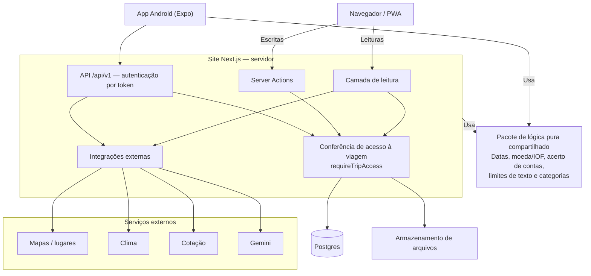

# Arquitetura

O navegador envia uma escrita para uma Server Action, que confere o acesso à viagem com `requireTripAccess` antes de acessar o banco.  
As leituras passam pela camada de servidor e também conferem o acesso; o app Android usa a API `/api/v1` com autenticação por token e a mesma exigência de acesso.  
Site e app usam o pacote de lógica pura, sem banco, framework ou módulos do Node; um teste impede importações proibidas.  
Para sugerir um roteiro, o servidor monta uma lista real de lugares do destino e envia ao Gemini apenas os dados mínimos, incluindo ritmo e interesses, sem nome, e-mail ou texto livre.  
O Gemini devolve uma resposta em JSON Schema; o servidor limpa e revalida a sugestão quanto à lista de lugares, às datas da viagem, aos horários e à distância entre lugares do dia.  
A sugestão segue para a tela de revisão, onde a pessoa confere dia por dia e confirma; ao gravar, os dados de cada lugar vêm da lista mantida pelo servidor.  
Serviços externos ficam atrás do servidor, com prazo por chamada e retorno vazio em falhas; blocos dependentes carregam com Suspense para preservar o restante da tela.
